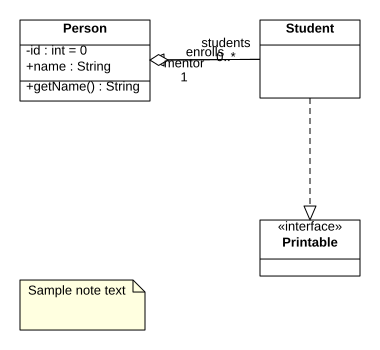

# OpenStar UML

**A free and open-source UML modeling tool — Model · Design · Document.**

OpenStar UML is a desktop UML modeler built as a fully FOSS (MIT-licensed), clean-room
homage to the classic StarUML experience: the same dark three-panel workspace
(Model Explorer · Diagram Canvas · Property Editor), the same `.mdj` project format,
per-diagram toolboxes, and a full UML diagram suite — with zero paywalls, zero nag
screens, and zero telemetry.

> **This program was made fully by Qwen.** Every line of code, the test suite, the
> documentation and the artwork in this repository were written by Qwen, an AI
> assistant, from an empty directory.

> Not affiliated with, endorsed by, or derived from StarUML / MKLab. This is an
> independent clean-room implementation. "StarUML" is a trademark of its owner.
> `.mdj` compatibility is achieved through the publicly observable file format.



---

## Features

### Diagrams (full suite)

| Diagram | Toolbox highlights |
|---|---|
| **Class** | Class, Interface, Enumeration, Data Type, Package, Association, Directed Association, Aggregation, Composition, Generalization, Realization, Interface Realization, Dependency |
| **Use Case** | Actor, Use Case, Boundary/Subject, Association, Generalization, Dependency, Include, Extend |
| **Sequence** | Lifeline, Sync/Async/Reply/Create/Delete/Self Message, Combined Fragments (alt/opt/loop/par/…), activations, destruction markers |
| **Statechart** | State, Composite State (nesting), Initial, Final, Choice, Junction, Fork, Join, Shallow/Deep History, Entry/Exit Points, Terminate, Transition with `trigger [guard] / effect` labels |
| **Activity** | Action, Object Node, Initial, Activity Final, Flow Final, Decision, Merge, Fork, Join, Control Flow, Object Flow |
| **Component** | Component, Artifact, Interface, Assembly Connector, Provided/Required Interface, Dependency |
| **Deployment** | Node (3D), Artifact, Component, Instance, Communication Path, Dependency |
| **Package** | Package, Model, Subsystem, Dependency, Generalization |

Notes and Note Links are available on every diagram.

### Editing

- Infinite canvas: pan (space/middle-drag), zoom (Ctrl+wheel, 10%–400%), fit-to-window, dot grid + snapping
- Marquee & shift multi-select, 8-handle resize, edge bend points, endpoint re-attach
- Drag-to-connect tools with UML validity checks per relationship type
- Container nesting (packages, composite states, fragments, nodes…) with automatic
  z-ordering and child-follows-parent dragging
- Inline rename (double-click / F2), Model Explorer tree with drag-to-reparent and
  drag-to-diagram
- Full undo/redo (100 steps), copy/cut/paste/duplicate with deep model cloning
- Align (6), distribute (2), z-order (4), nudge with arrow keys
- Property Editor with Model / Format / Documentation sections, live two-way binding,
  editable attribute/operation/parameter/literal/association-end lists,
  fill & line colors, fonts (family/size/B/I/U), per-type view flags
  (`suppressAttributes`, `showMultiplicity`, line style, word wrap…)
- Dark (StarUML-style) **and** light themes; resizable panels; multi-diagram tabs

### Files & interoperability

| Format | Read | Write | Notes |
|---|:---:|:---:|---|
| `.mdj` (StarUML project) | ✓ | ✓ | Tolerant reader; unknown element/view types are preserved verbatim and round-trip safely |
| XMI 2.1 | ✓ | ✓ | Pragmatic UML 2 profile; imports files from other UML tools (tested against Eclipse UML2-style XMI) |
| PNG | — | ✓ | 2× resolution, tight bounds |
| SVG | — | ✓ | Vector-perfect; same drawing code as the canvas |
| PlantUML | — | ✓ | Per diagram or whole project |
| Markdown | — | ✓ | Full model documentation with tables |
| Print | — | ✓ | Via File ▸ Export / toolbar |

Other: recent-files list, `.mdj` file association (double-click to open), autosave-free
clean exits with unsaved-changes guard, crash-safe JSON project format.

---

## Getting started

```bash
git clone <this repo> openstar-uml
cd openstar-uml
npm install        # installs Electron (dev dependency only)
npm start          # launch the app
```

Try it immediately: **File ▸ Open…** → `samples/demo.mdj` (a mini e-commerce model
with all 7 diagram types).

Open `renderer/index.html` directly in a browser and the app also runs as a web app
(file dialogs fall back to download/upload) — handy for development without Electron.

### Packaging desktop installers

```bash
npm run dist       # AppImage/deb/rpm, NSIS, dmg/zip via electron-builder
```

Add `build/icon.png` (512×512+) or platform icons to replace the default Electron icon;
`assets/icon.svg` is the source artwork.

---

## Keyboard shortcuts

| Action | Shortcut |
|---|---|
| New / Open / Save / Save As | `Ctrl+N` `Ctrl+O` `Ctrl+S` `Ctrl+Shift+S` |
| Undo / Redo | `Ctrl+Z` / `Ctrl+Shift+Z` |
| Cut / Copy / Paste / Duplicate | `Ctrl+X` `Ctrl+C` `Ctrl+V` `Ctrl+D` |
| Delete selection | `Del` |
| Select all | `Ctrl+A` |
| Rename | `F2` or double-click |
| Zoom in / out / actual / fit | `Ctrl+=` `Ctrl+-` `Ctrl+0` `Ctrl+Shift+F` |
| Pan canvas | `Space`+drag or middle-mouse drag |
| Nudge | Arrow keys (`Shift` = grid step) |
| Axis-locked move | `Shift` while dragging |
| Keep tool active after placing | `Shift`+click |
| Cancel tool / deselect | `Esc` |

---

## Development

### Architecture

```
main/                  Electron main process
  main.js              windows, IPC (files, dialogs, print, recents), single-instance
  menu.js              native menu built from shared defs (renderer/js/ui/menu-defs.js)
  preload.js           contextBridge API (window.OpenStar) — sandboxed, no node in renderer
renderer/
  index.html  css/app.css
  js/
    lib/               util (ids, geometry), textmetrics (font & measurement),
                       xml (mini parser/serializer), bridge-fallback (browser mode)
    core/              metamodel (all UML types, toolboxes, property schemas),
                       model (lifecycle, cascades, label formatting),
                       project (registry, transactions, undo/redo), clipboard
    gfx/               dual-backend drawing API: CanvasGfx (screen/PNG) + SvgGfx (export)
    diagrams/          views (layout/draw/hit/anchor/route per view type),
                       editor (interactive canvas engine)
    formats/           mdj, xmi, plantuml, markdown, image
    ui/                explorer, toolbox, tabs, property-panel, dialogs, menubar, icons
    app.js             bootstrap, command registry, wiring
tests/                 390+ assertions, runs headless: node tests/run-all.js
```

Design notes:

- **No frameworks, no bundler.** Plain ES5-style JS with a tiny `OS` namespace so the
  exact same modules run in the browser, in Electron, and in Node tests.
- **Snapshot-based undo**: every transaction captures before/after project state via the
  `.mdj` serializer — simple, exact, and battle-tested by the round-trip tests.
- **Tolerant `.mdj` reader**: unknown `_type`s become generic preserved elements/views
  (rendered as placeholders, re-serialized verbatim), so opening a file from a newer
  StarUML never loses data.
- **One drawing code path** for screen, PNG and SVG (the `Gfx` abstraction).

### Tests

```bash
npm test             # pure-Node suites; UI suite runs if jsdom is installed
```

The UI smoke test boots the *entire* renderer inside jsdom (stubbed 2D canvas) and
drives real interactions: explorer clicks, property edits, drag-move with undo,
toolbox creation, edge tools, clipboard, tabs, dialogs, exports and file round-trips.

Regenerate sample assets after engine changes:

```bash
node scripts/make-sample.js          # samples/demo.mdj (+ verifies byte-identical round-trip)
node scripts/export-sample-svgs.js   # samples/*.svg
```

---

## Known limitations (v1.0)

- Activity diagram swimlanes/partitions are not implemented yet
- Sequence: no lost/found messages; combined-fragment operands are laid out evenly
  (not sized to content); activation bars are fixed-height
- UML Profile / ERD / Communication / Wireframe diagrams (StarUML extensions) are out
  of scope; foreign diagram types in `.mdj` files open read-only-ish with placeholder
  views and round-trip safely
- `.mdj` label micro-positioning (dragged label offsets, `alpha` tweaks) is recomputed
  on load rather than preserved pixel-exact
- XMI carries model semantics, not diagram views (same as StarUML's XMI)

Contributions welcome — see issues/roadmap.

## License

MIT — see [LICENSE](LICENSE).
